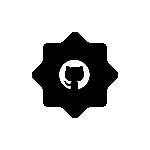
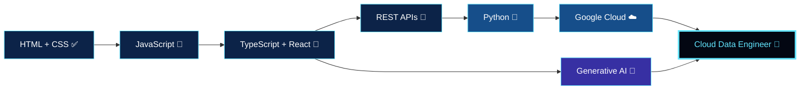

<!-- HERO: ghost sits right next to the typing text -->
<table>
  <tr>
    <td align="center" width="120">
      
    </td>
    <td align="center">
      
    </td>
    <td align="center" width="120">
      
    </td>
  </tr>
</table>

  

&nbsp;&nbsp;
&nbsp;&nbsp;
&nbsp;&nbsp;
&nbsp;&nbsp;

---

- 🇵🇰 Developer from Pakistan
- 💻 Passionate about frontend development and modern web experiences
- 🌱 Learning JavaScript, TypeScript, REST APIs, and cloud technologies
- ☁️ Working toward Cloud Data Engineering and Generative AI
- 🎨 Interested in responsive UI, animations, and interactive websites
- 🎬 Exploring AI filmmaking and cinematic prompt engineering

**BUILD TODAY. LEVEL UP TOMORROW.**

---

> 🪟 **[ SYSTEM ]** — *Status window loaded.*

| | |
|:--|:--|
| 🧑‍💻 **NAME** | Abdul Samad |
| 🏷️ **CLASS** | Frontend Developer |
| 🎯 **JOB CHANGE QUEST** | Cloud Data Engineer · GenAI Builder |
| 🌍 **LOCATION** | Pakistan 🇵🇰 |
| ⚔️ **MAIN WEAPONS** | HTML · CSS · JavaScript · React |
| 🛡️ **SKILLS UNLOCKING** | TypeScript · Python · REST APIs · GCP |
| 🎬 **SIDE QUEST** | AI Filmmaking · Prompt Engineering |

**LEVEL PROGRESS**

 &nbsp;**Frontend** 
 &nbsp;**JavaScript / TypeScript** 
 &nbsp;**Cloud & Data** 
 &nbsp;**Generative AI**

---

---

  

  

---

---

| Project | Description |
|---|---|
| 🌐 **Portfolio Website** | Personal brand, skills, and projects |
| 💻 **Frontend Projects** | Modern websites and interactive UI |
| 🚘 **Interactive 3D Car Website** | 3D visuals and web animations |
| 🎬 **AI Video Projects** | Cinematic AI filmmaking and storytelling |
| 🤖 **Generative AI Experiments** | AI tools and prompt engineering |

---

  

---

  

<b>💡 Fun facts (click to open)</b>

 

- 🎌 Solo Leveling is the mindset: *"I alone level up."*
- 👻 The ghost is my coding companion — it haunts my bugs.
- 🎬 I mix code and cinema: websites + AI films.

 

### "Keep learning. Keep building. Never stop leveling up."

⚡ **CODE · CREATE · INNOVATE · LEVEL UP** ⚡

 

### 👑 THANKS FOR VISITING MY PROFILE 👑

**💙 HAPPY CODING · ARISE ⚔️**

